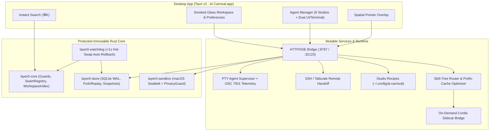

<div align="center">

# 🎡 Carnival

### One smoked-glass Mac window for every AI agent, studio, and workflow you run.

Command multiple coding agents side by side, watch them work inside live pixel worlds, talk to your screen out loud, automate routines, and burst heavy tasks to a bigger machine over SSH or Tailscale.

[✨ What you can do](#what-you-can-do) · [🎮 Studio worlds](#watch-your-agents-work-literally) · [🚀 Get started](#get-started) · [⌨️ Shortcuts](#keyboard-shortcuts) · [💬 FAQ](#faq)

<!-- Drop a hero screenshot or short screen recording here: docs/images/hero.png -->

</div>

---

## Stop babysitting twelve terminal tabs

If you build with AI agents today, your screen probably looks like a yard sale: one CLI agent running in a split pane, another waiting silently on a permission prompt, a third that finished twenty minutes ago without saying a word, and a browser tab open just to preview what it built.

**Carnival** pulls your whole AI workflow into one native, jet-black smoked-glass Mac app. Run your existing command-line agents untouched, spin up multi-agent teams, schedule recurring automations, talk to your screen hands-free, and offload massive jobs to a stronger machine—all without leaving the window.

---

## What you can do

### 🧠 Five ways to work, right from the composer

Every project lives in a **Studio** tucked cleanly into a bottom dock, and every session is an **Act** (`⌥⌘N`). Pick how much firepower you want before you hit Enter:

| Mode | Built for |
|---|---|
| **Standard** | Everyday coding, searching, file editing, and terminal work. |
| **Orchestrator** | Coordinating multi-step, multi-agent work across your codebase. |
| **Codeforge** | Scripted TypeScript tool pipelines that batch, filter, and summarize at scale. |
| **Spark** | Fast, lightweight runs with direct terminal access, vision reading, and auto-compaction. |
| **Artisan** | Building new **Attractions** (plugins), custom modes, and UI tweaks just by asking. |

---

### 🤖 Supervise every coding agent in one place

Open the **Agent Manager (`⌘⇧A`)** to run **Claude Code, Codex CLI, Gemini CLI, OpenCode**, custom shell commands, and Carnival's built-in **Orchestrator** side by side.

- **Instant status at a glance:** See who is *typing*, *needs you*, *shipped*, or *on break*.
- **One-click approvals & broadcasts:** Approve or deny permission prompts right in Carnival, or send one instruction to every active agent at once.
- **UI ↔ Terminal in one click:** Read clean, structured conversation cards or flip straight into the live raw terminal for any pane.

---

### 🎮 Watch your agents work, literally

Carnival turns your active crew into a living scene. Pixel-art characters sit at desks, type when your agents type, raise a hand when blocked, and celebrate when they ship—synced live with every pane header and sidebar portrait.

| World | The vibe |
|---|---|
| 🐱 **Pixel HQ** | A late-night engineering office full of pixel pets on MacBooks, complete with job-title nameplates. |
| 🏢 **Officetime** | A top-down studio floorplan where busy coworkers type, raise hands for help, and cheer on ship. |
| 🏰 **World of Codecraft** | An isometric fantasy village where your spaces become heraldic districts and agents roam as heroes. |
| 🏔️ **Middle-earth** | A pixel Fellowship marching between Shire hills and Mordor gates while your agents write code. |

Prefer clean silence over pixel art? Switch to five focus-first layouts anytime:

- **Kanso** — Monochrome calm that floats blocked agents to the front.
- **Cockpit** — High-density, keyboard-first mission control strip.
- **Omarchy** — Crisp flat-tiled panes with a Spaces sidebar and live Changes inspector.
- **Islands** — Floating smoked-glass cards with generous breathing room.
- **Brutal Metrics** — Live token burn, cache hits, and context pressure right next to each agent.

---

### 🎨 Reshape the interface just by asking

Want tighter density, a Git diff rail, warm tones, or a view that shows only agents waiting on you? Describe it in plain English and Carnival rewrites its own layout on the fly—plus lets you toggle **5 built-in mods**.

Every reshape automatically saves a snapshot first, so **one click rolls it back** whenever you want to experiment freely.

---

### 🎙️ Talk to your screen & get a live pointer

Hold **Control + Option** anywhere on your Mac and ask a question out loud. Carnival's native Swift **Voice & Pointer Companion** sees your screen, answers aloud using **100% on-device Apple speech recognition and Siri neural voices** (no third-party voice API keys), and flies an on-screen highlight right to the exact button, menu, or control you asked about.

---

### ⚡ Offload heavy runs to a bigger machine

Have a Mac Mini on your desk, a lab workstation, or a friend's powerhouse laptop on Tailscale?

Carnival automatically discovers hosts from your `~/.ssh/config` and lets you add custom SSH or Tailscale peers in seconds. Dispatch any heavy task remotely in a couple of clicks—when it finishes, Carnival brings the work home as a **clean, reviewable git patch**. Your laptop stays cool and quiet, and nothing touches your local branch until you say so.

---

### 🧩 Full workspace superpowers built right in

Carnival isn't just a launcher—it ships with the tools agents actually need to finish real projects end to end:

- **🔍 Instant Search (`⌘K`)** — Searches file names and contents across your entire workspace as you type from an in-memory index.
- **🌐 Live Browser & Document Preview** — Let agents drive real browser workflows, inspect project files, run persistent terminals, and preview Markdown, PDF, and Office deliverables right inside the side drawer.
- **👥 Subagents, Teams & Goals** — Fork or spawn specialized subagents, run multi-agent teams with plans and to-do lists, and keep multi-hour sessions sharp with automatic tool-output pruning and image offloading.
- **⏰ Routines** — Put recurring prompts, audits, and summaries on autopilot with a built-in scheduler.
- **🔌 Attractions, Skills, MCP & Connectors** — Extend Carnival with installable plugins, skills, OAuth-enabled **MCP** servers, built-in **Web Search & Fetch**, and connectors for **Linear, Notion, Feishu, and DingTalk**.
- **🙈 Automatic Secret Masking** — Sensitive keys and tokens are automatically masked in your UI stream before they ever flash across your screen.

---

### 🛡️ Built to leave running safely

Giving agents real tools requires real guardrails:

- **Protected Rust core** — Automated tools and plugins cannot write to Carnival's own core crates or manifests, so an agent can never break the app supervising it.
- **Fail-closed macOS sandbox** — File writes stay inside explicit macOS Seatbelt boundaries, and desktop actions obey per-app permission envelopes.
- **Rewindable sessions** — Every turn is stored locally in SQLite (WAL) so you can inspect, fork, or replay any session.
- **Sub-second self-healing** — A built-in watchdog verifies live adapter swaps and rolls back any failure in **under 1 second**.

---

### 🖤 Feels like a real Mac app

- **Jet Black Smoked Glass** — Native macOS translucency with an opacity slider, **Crystal** mode, and runtime switches (`Voice`, `Cache`, `Skills`, `Forge`, `Local`) tucked cleanly inside **Preferences → General**.
- **Clean lifecycle** — Relaunching focuses your existing window instead of spawning duplicates; clicking the red close button tucks Carnival into the Dock; quitting tears down every spawned PTY and child process with zero stray listeners left behind.

---

## Get started

Carnival currently builds from source on **macOS (Apple Silicon)**.

### What you need

- macOS on Apple Silicon (`arm64`)
- [Rust](https://rustup.rs) & Cargo
- Node.js `24.22+` and `pnpm 11`
- Xcode *(optional — only needed to build the Swift Voice & Pointer Companion)*

### Build & run

**1. Build the workspace runtime**

```bash
cd runtime
pnpm install
pnpm run build:artifacts
cd ..
```

**2. Run a quick health self-check**

```bash
export PATH="$HOME/.cargo/bin:$PATH"
cargo run -p carnival-daemon -- --workspace . --self-check
```

**3. Build and launch Carnival**

```bash
cd desktop/src-tauri
cargo build --release
```

Want hot development mode instead? Run `cargo run` inside `desktop/src-tauri`.

Prefer running just the headless background daemon?

```bash
cargo run -p carnival-daemon -- --workspace . --companion-port 8787 --bridge-port 32123
```

---

## Keyboard shortcuts

| Shortcut | Action |
|---|---|
| **⌘⇧A** | Open the Agent Manager |
| **⌘K** | Instant workspace & code search |
| **⌥⌘N** | Start a new Act (session) |
| **Control + Option** *(hold)* | Talk to the Voice & Screen Pointer Companion |

---

## FAQ

**Which CLI agents work with Carnival?**
Claude Code, Codex CLI, Gemini CLI, OpenCode, any shell script or CLI you want to supervise, plus Carnival's built-in Orchestrator. It launches your real local binaries—no wrappers or vendor lock-in.

**Does the voice companion send my audio to a third-party speech API?**
No. Speech recognition and speech playback both run 100% locally on your Mac using Apple's built-in `Speech.framework` and Siri neural voices. Screen context and prompts are only sent to whichever AI model backend you configure.

**What if I mess up my workspace while shaping the UI?**
Hit rollback. Every layout edit saves a snapshot first, so one click brings back your previous workspace.

**How does remote handoff keep my local repo safe?**
Tasks run over your own SSH or Tailscale connection on machines you explicitly add. Changes come back as a git patch for you to inspect before applying.

**What platforms are supported?**
Carnival is built and tested for **macOS on Apple Silicon**.

---

## For developers

<details>
<summary><b>Under the hood — architecture, layout & tests</b></summary>

<br>

Carnival combines a **Tauri v2** native macOS shell, a **layered Rust workspace** (separating the immutable core from mutable services), a **TypeScript multi-model workspace runtime**, and a **native Swift voice & spatial pointer companion**.



**Repository layout**

```text
contracts/            Shared JSON Schema & TypeScript protocol types
crates/
  layer0-contracts/   Shared traits, capability envelopes & protocol types
  layer0-core/        ImmutableCoreGuard, SeamRegistry, EffectGuard & WorkspaceIndex
  layer0-store/       SQLite (WAL) event store, session fork/replay & snapshots
  layer0-sandbox/     macOS Seatbelt (sandbox-exec) & PrivacyGuard
  layer0-watchdog/    6-stage hot-swap verification & <1s auto-rollback
  layer1-cordis-bus/  Lazy Node.js sidecar supervisor over stdio JSON-RPC
  layer1-router/      Hierarchical skill-tree router & prefix-cache optimizer
  layer1-adapters/    Axum bridge, AgentManager, StudioRecipes & RemoteHandoff
  carnival-daemon/    Standalone daemon & self-check binary
desktop/              Tauri v2 macOS shell & web surfaces (Agent Manager, Search, Overlay)
runtime/              Multi-model workspace server, presets, MCP, workflows & connectors
companion/            Native Swift voice & screen-pointer app
sidecars/             On-demand JSON-RPC sidecar bridge
docs/                 ARCHITECTURE.md, COMPANION.md
```

**Local ports & endpoints**

| Port | Role |
|---|---|
| `3080` | Workspace & Preferences UI |
| `8787` | Voice & spatial pointer companion bridge |
| `32123` | Control, Agent Manager, Studio & Remote Handoff API |

- Studio API: `GET /studio/recipes`, `POST /studio/shape`, `POST /studio/rollback`
- Handoff API: `GET/POST /remote/peers`, `POST /remote/handoff`, `POST /remote/handoff/:handoff_id/receive`
- Config & preferences live in `~/.config/ai-carnival/` (`ui_prefs.json`, `layouts/`, `mods/`) and hot-reload without restarting.

**Run tests**

```bash
export PATH="$HOME/.cargo/bin:$PATH"
cargo check --workspace
cargo test --workspace
```

Rebuild runtime bundles:

```bash
cd runtime
pnpm run build:artifacts
```

See [`docs/ARCHITECTURE.md`](docs/ARCHITECTURE.md) and [`docs/COMPANION.md`](docs/COMPANION.md) for deeper technical notes.

</details>

---

<div align="center">

**🎡 Carnival** · Built for people who run more than one agent at a time.

</div>
