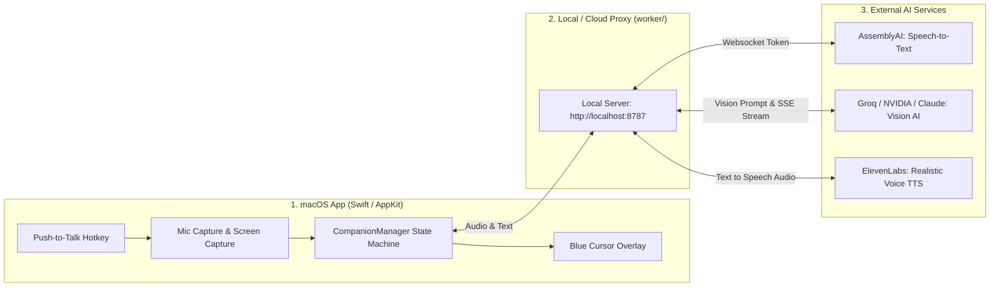

pl# Clicky — Complete Beginner & Architecture Guide

Welcome! If you are new to Swift, macOS desktop development, or this codebase, this guide explains **what Clicky is**, **how it works under the hood**, **why the project is structured this way**, and **how every file connects together**.

---

## 1. What is Clicky? (The Big Picture)

**Clicky is a native macOS "AI buddy" that lives on your screen.**

Instead of switching back and forth to ChatGPT or Claude in a browser tab:
1. You hold down a keyboard shortcut (**`Control + Option`**).
2. You speak out loud to your computer while looking at your screen (e.g., *"How do I fix this bug?"* or *"Where is the download button?"*).
3. When you release the keys, Clicky:
   - Takes a screenshot of your screen(s).
   - Transcribes your voice in real-time.
   - Sends the screenshot + transcript to an AI model (Groq, NVIDIA Nemotron, OpenRouter, or Claude).
   - Plays the AI's response in your headphones/speakers using a natural human voice.
   - Flies a blue cursor companion directly over the UI element you asked about and points to it.

---

## 2. System Architecture: The Two Halves

The project consists of two separate components:

### Why is there a Backend Proxy (`worker/`)?
You might wonder: *why not call Groq, ElevenLabs, and AssemblyAI directly from the Swift app?*
1. **Security**: If the app called APIs directly, your private API keys would be baked into the compiled Mac application binary, where anyone could decompile and steal them.
2. **Format Translation**: The Swift app expects Anthropic's streaming format. The worker acts as an adapter, allowing you to swap between **Groq**, **NVIDIA Nemotron**, **OpenRouter**, or **Claude** without changing Swift code.

---

## 3. Core macOS Concepts (For Non-Swift Developers)

If you come from Python, JavaScript, or Web Development, macOS development has a few unique patterns:

### A. Menu Bar-Only App (`LSUIElement = true`)
Normally, Mac apps have an icon in the Dock and a main application window. Clicky sets `LSUIElement = true` in its `Info.plist`. This tells macOS:
- Do not show an icon in the Dock.
- Do not show standard window frames.
- Run purely as a status bar accessory (in the top menu bar).

### B. Transparent Cursor Overlay (`NSPanel`)
How does Clicky draw a floating blue cursor and text on top of your entire screen without blocking you from clicking other apps?
- It uses a borderless, transparent **`NSPanel`** that covers all connected monitors.
- It is set to `.nonActivatingPanel` so it **never steals focus** from whatever app you are using (VS Code, Chrome, etc.).
- It joins all macOS Spaces/Desktops so it follows you everywhere.

### C. Global Event Tap (`CGEventTap`)
Standard macOS apps can only detect key presses when their window is focused. Clicky uses a **listen-only CoreGraphics Event Tap** (`CGEventTap`). This allows Clicky to detect when you press **`Control + Option`** from anywhere in the OS, even when you're playing a game or typing in another app.

### D. MVVM Pattern & Reactive State
- **`@Published`**: Similar to React's `useState` or MobX observables. When a `@Published` variable changes, the UI automatically re-renders.
- **`@MainActor`**: Ensures that all UI updates happen on macOS's main thread (preventing UI glitches and app crashes).

---

## 4. Complete File Structure Tour

Here is a map of every important file in the project and what it does:

### 📁 Root Directory
| File | What it is |
| :--- | :--- |
| `leanring-buddy.xcodeproj` | The Xcode project file. (The "leanring" typo is legacy/intentional from the author). |
| `AGENTS.md` | Single source of truth for coding guidelines, architecture rules, and conventions. |
| `worker/` | The proxy server (Cloudflare Worker / Node.js) holding API keys and routing requests. |

---

### 📁 `leanring-buddy/` (The Native Mac App)

#### 1. App Entry & Menu Bar
* **`leanring_buddyApp.swift`**: The entry point of the app (like `index.js` or `main.py`). Sets up the application delegate and initializes the managers.
* **`MenuBarPanelManager.swift`**: Creates the status item icon in your top macOS menu bar and manages the dropdown panel.
* **`CompanionPanelView.swift`**: The SwiftUI visual menu that appears when you click the menu bar icon (where you choose models like Groq, Sonnet, or Nemotron, see microphone status, and quit).

#### 2. The Brain (State Machine)
* **`CompanionManager.swift`**: The **central nervous system** of Clicky (~1,000 lines). It coordinates:
  - Detecting the hotkey press → starting the audio recording.
  - Releasing the hotkey → snapping screenshots and stopping recording.
  - Sending the data to the proxy server.
  - Streaming text responses to the overlay.
  - Triggering ElevenLabs voice playback.
  - Parsing coordinate tags (`[POINT:x,y]`) to move the cursor.

#### 3. Voice Input & Speech-to-Text
* **`BuddyDictationManager.swift`**: Captures microphone audio using Apple's `AVAudioEngine` and calculates live audio levels for the speech waveform.
* **`BuddyTranscriptionProvider.swift`**: The protocol (interface) defining how transcription backends communicate.
* **`AssemblyAIStreamingTranscriptionProvider.swift`**: Streams live PCM microphone audio over a WebSocket to AssemblyAI's real-time model (`u3-rt-pro`) to transcribe your voice with zero latency.
* **`AppleSpeechTranscriptionProvider.swift`**: Local offline speech recognition fallback using Apple's built-in speech framework.
* **`OpenAIAudioTranscriptionProvider.swift`**: Fallback provider for Whisper audio uploads.

#### 4. Screen Capture & Pointing
* **`CompanionScreenCaptureUtility.swift`**: Takes ultra-fast multi-monitor screenshots using Apple's modern **ScreenCaptureKit** framework.
* **`OverlayWindow.swift`**: The transparent full-screen overlay window. Renders the blue cursor, speech bubble, spinner, and animates bezier curves to fly the cursor to UI elements.
* **`CompanionResponseOverlay.swift`**: The SwiftUI view rendered next to the blue cursor showing Clicky's text responses.

#### 5. AI API Clients
* **`ClaudeAPI.swift`**: Sends chat requests to the proxy server and parses Server-Sent Events (SSE) streaming chunks for progressive text display. Updated to support both Anthropic and OpenAI/Groq SSE formats!
* **`ElevenLabsTTSClient.swift`**: Sends response text to the proxy server to get MP3 voice audio from ElevenLabs and plays it using `AVAudioPlayer`.
* **`OpenAIAPI.swift`**: OpenAI-compatible client implementation.

#### 6. Helpers & Design Tokens
* **`GlobalPushToTalkShortcutMonitor.swift`**: Listens for the `Control + Option` global hotkey.
* **`DesignSystem.swift`**: Colors, corner radii, fonts, and dark-theme tokens (`DS.Colors`, `DS.CornerRadius`).
* **`AppBundleConfiguration.swift`**: Reads configuration settings from `Info.plist`.

---

### 📁 `worker/` (The Proxy Server)

* **`worker/src/index.ts`**: The TypeScript server code.
  - Handles `POST /chat` → Converts requests and streams responses from **Groq** (`qwen/qwen3.8-27b`), **NVIDIA Nemotron**, **OpenRouter**, or **Claude**.
  - Handles `POST /tts` → Calls **ElevenLabs** text-to-speech.
  - Handles `POST /transcribe-token` → Generates temporary WebSocket tokens from **AssemblyAI**.
* **`worker/.dev.vars`**: Private local environment variables file (holds your `GROQ_API_KEY`, `ELEVENLABS_API_KEY`, and `ASSEMBLYAI_API_KEY`). **Never committed to git.**
* **`worker/wrangler.toml`**: Cloudflare deployment configuration.

---

## 5. Life of a Request: What Happens When You Talk?

Here is the step-by-step timeline of an interaction:

1. **You press `Control + Option`**:
   - `GlobalPushToTalkShortcutMonitor` detects the event.
   - `CompanionManager` switches state to `.listening`.
   - `BuddyDictationManager` opens the mic and streams audio to AssemblyAI.
   - The blue cursor fades onto your screen with an audio waveform.

2. **You release `Control + Option`**:
   - `BuddyDictationManager` finalizes the voice transcript (e.g. *"Where is my downloads folder?"*).
   - `CompanionScreenCaptureUtility` grabs a screenshot of your screen via `ScreenCaptureKit`.
   - `CompanionManager` switches state to `.processing`.

3. **Inference**:
   - The screenshot + transcript are POSTed to `http://localhost:8787/chat`.
   - The worker adapts the image to `image_url` and sends it to **Groq** (`qwen/qwen3.8-27b`).
   - Groq streams text back in milliseconds.

4. **Response & Voice**:
   - As text chunks arrive, `ClaudeAPI.swift` streams them into `OverlayWindow` so words appear progressively on your screen.
   - Once the response finishes, `ElevenLabsTTSClient` sends the text to `/tts` and speaks the response aloud in George's voice.

5. **Pointing (If applicable)**:
   - If the AI included a `[POINT:x,y:label:screen1]` tag, `OverlayWindow` calculates the exact pixel position on your monitor and animates the blue cursor in a smooth arc to point directly at the UI element!

---

## 6. Summary Cheat Sheet

| Question | Answer |
| :--- | :--- |
| **Where are my API keys stored?** | In `worker/.dev.vars` (safe from git and never compiled into the Mac app). |
| **Which AI model am I using?** | Groq's multimodal `qwen/qwen3.8-27b` (ultra-fast vision model). |
| **How does voice-to-text work?** | AssemblyAI streams PCM16 audio over a WebSocket. |
| **How does text-to-speech work?** | ElevenLabs generates audio through the `/tts` proxy route. |
| **Why is Xcode needed?** | Swift and macOS desktop frameworks (`ScreenCaptureKit`, `AppKit`, `SwiftUI`) must be compiled into a `.app` bundle by Apple's build tools. |
