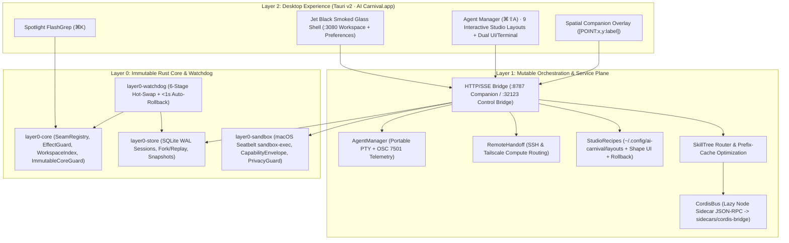

# Carnival Architecture Blueprint

> **Target Platform:** macOS `arm64` (Apple Silicon) with Tauri v2 desktop shell, Rust runtime crates, Node.js workspace runtime, and native Swift voice/spatial companion.

---

## 1. Three-Layer System Design



---

## 2. Repository Modules

| Path | Responsibility |
|---|---|
| `crates/layer0-*` | Immutable core guards, resident `WorkspaceIndex` (`FlashGrep`), SQLite WAL session store, macOS Seatbelt sandbox, and `<1s` Watchdog rollback. |
| `crates/layer1-*` | Skill-tree & prefix-cache router, lazy Cordis sidecar bus, Axum HTTP/SSE bridge (`:8787` & `:32123`), PTY Agent Manager, Studio Recipes, and SSH/Tailscale Remote Handoff. |
| `crates/carnival-daemon/` | Headless daemon binary supporting `--self-check` and background bridge serving. |
| `desktop/src-tauri/` & `desktop/web-shell/` | Native macOS Tauri v2 shell (`AI Carnival.app`), Smoked Glass UI, Spotlight `⌘K`, Spatial Overlay, and Agent Manager `⌘⇧A`. |
| `runtime/` | Multi-model web workspace server (`dsh web`), Cordis microkernel, PTC runtime, and Orchestrator preset. |
| `companion/` | Native macOS Swift screen-and-voice companion (`Ctrl + Option` push-to-talk, on-device Apple Speech + Siri neural TTS, ScreenCaptureKit). |
| `sidecars/cordis-bridge/` | Lazy on-demand Node.js JSON-RPC bridge between Rust services and `runtime/` + `companion/`. |
| `contracts/` | Cross-component JSON Schema and TypeScript contract definitions. |

---

## 3. Security & Lifecycle Guarantees

- **Immutable Core Protection**: `ImmutableCoreGuard` blocks Layer-1 writes targeting `crates/layer0-*`, `Cargo.toml`, `Cargo.lock`, or `crates/carnival-daemon`.
- **macOS Seatbelt (`sandbox-exec`) & PrivacyGuard**: `layer0-sandbox` enforces SBPL v1 write restrictions outside authorized directories, and `PrivacyGuard` blocks background screen/audio capture without an explicit active grant.
- **Process Hygiene**: `AI Carnival.app` enforces single-instance window focus, hides to the Dock on red-button close, tears down active PTY workers via `AgentManager::stop_all()`, and terminates its child process group cleanly on quit or `SIGTERM`.

---

## 4. Local Runbook

```bash
# Run full Rust workspace test suite
export PATH="$HOME/.cargo/bin:$PATH"
cargo check --workspace
cargo test --workspace

# Run daemon self-check
cargo run -p carnival-daemon -- --workspace . --self-check

# Build & launch macOS desktop app
cd desktop/src-tauri
cargo run
```
